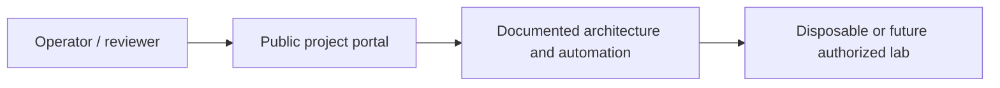

# AZUREBRIDGE | Hybrid Cloud Infrastructure Platform

**Author:** Pratik Aeraple
**Public demonstration:** https://azurebridge.brutehack.com
**Project status:** Terraform architecture: IMPLEMENTED · Local formatting/validation: LAB VALIDATED · Azure deployment: REQUIRES EXTERNAL PLATFORM

## Problem and objectives

A Terraform-led hybrid Azure reference environment with segmented networking, managed identity, least-privilege RBAC, monitoring and a deployment boundary that prevents accidental paid provisioning.

This repository is a portfolio engineering project, not a claim that an enterprise environment or vendor tenant exists. The status labels apply to the specific artifacts described below.

## Architecture



BruteHost / private lab → IPsec site-to-site VPN gateway → Azure hub VNet → workload subnet and private services. Bastion or point-to-site access is an alternate operator path, not a public RDP/SSH rule.

## What is implemented

- A production-built, non-root, read-only static demonstration portal with a project-specific health identity and exact hostname allowlist.
- A version-constrained AzureRM root configuration, environment inputs, outputs, deployment guard and state-protection guidance.
- A no-deployment-by-default Terraform root for segmented VNet/subnets, deny-inbound NSG, managed identity and separately opt-in Log Analytics/Linux VM resources.
- A clear implementation-status vocabulary and security-first setup instructions.

## Designed, simulated and external-platform work

No Azure subscription was accessed and no cloud resources were created. Validation is local; plan/apply requires an owner-selected subscription and explicit cost review.

- **DESIGNED:** BruteHost / private lab → IPsec site-to-site VPN gateway → Azure hub VNet → workload subnet and private services. Bastion or point-to-site access is an alternate operator path, not a public RDP/SSH rule.
- **PLANNED / EXTERNAL PLATFORM REQUIRED:** actual vendor infrastructure, tenant-wide policy, hardware or customer operations not present in this repository.

## Repository map

- `web/` — public project portal, diagrams and search metadata.
- `src/server.mjs` — dependency-free Node static server, allowlisted hosts, TLS redirect awareness, CSP/security headers and health identity.
- `tests/` — Node built-in HTTP behavior tests.
- `docs/` — deployment/cost guard, hybrid topology, security/operations design, and official references.
- `terraform/` — AzureRM 5.10 constrained reference configuration; every resource is gated off by default and requires a deliberate cost acknowledgement to plan creation.
- `Dockerfile` — pinned Node runtime, non-root user, read-only-compatible filesystem and healthcheck.

## Run locally

Requirements: Node.js 24.22.1 or compatible Node 24 release for the portal. Terraform 1.17.1 plus AzureRM provider 5.10.x for configuration validation; no Azure login is needed for formatting/validation.

```bash
npm test
npm run check
PORT=8080 npm start
curl -H 'Host: azurebridge.brutehack.com' -H 'X-Forwarded-Proto: https' http://127.0.0.1:8080/healthz
```

The health endpoint returns only `azurebridge-ready`; it is a deterministic identity marker, not uptime evidence. For Docker, build this directory and map port 8080 only on a private Docker network. Do not publish a host port.

## Portal status vocabulary

- **IMPLEMENTED** — source/configuration exists in this repository.
- **LAB VALIDATED** — the named behavior was exercised in the isolated disposable lab.
- **DESIGNED** — architecture or policy artifacts exist but were not applied.
- **PLANNED** — future work.
- **REQUIRES EXTERNAL PLATFORM** — needs vendor tenant, licensed system, physical network or dedicated virtualization host.

## Security and privacy

No credentials or cloud state belong here. No analytics, external fonts, third-party scripts, telemetry, form collection, Docker socket or public administrative API is used. Network tooling is limited to localhost and owned lab targets. Never run destructive recovery against production.

## Troubleshooting

- `421 Unknown host`: use the exact project host listed above.
- `308`: the request did not arrive with trusted HTTPS scheme information; verify the reverse-proxy forwarding chain.
- `/healthz` mismatch: check that the expected project image is deployed; do not treat a generic 200 as project health.
- `404`: only committed static portal files are served; directory listing is disabled.

## Lessons and next work

The repository contains Terraform for a private Linux workload network, NSG rules, managed identity, monitoring and optional resources. No subscription ID, credentials, Terraform state or cloud resource is included. Expand the lab only when the required Windows, Azure, network or virtualization platform is available and its cost/security boundary is approved.

See [`docs/deployment.md`](docs/deployment.md) for the cost guard, state handling and validation procedure. No Azure resource has been applied; public portal labels distinguish the Terraform artifact from an actual Azure deployment.

## Author

Pratik Aeraple
