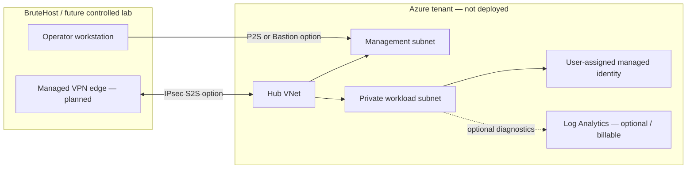

# AZUREBridge reference architecture

The solid boundaries describe code-defined network resources; all Azure components remain **DESIGNED** until an owner-approved subscription deployment is actually performed. The VPN and Bastion links are architecture options only, not Terraform resources in this initial safe baseline.

Addressing uses `10.84.0.0/16` by default, with workload `10.84.10.0/24` and management `10.84.20.0/24`. Validate these ranges against every connected network before deployment. No route propagation or address overlap claim has been tested against an external network.
